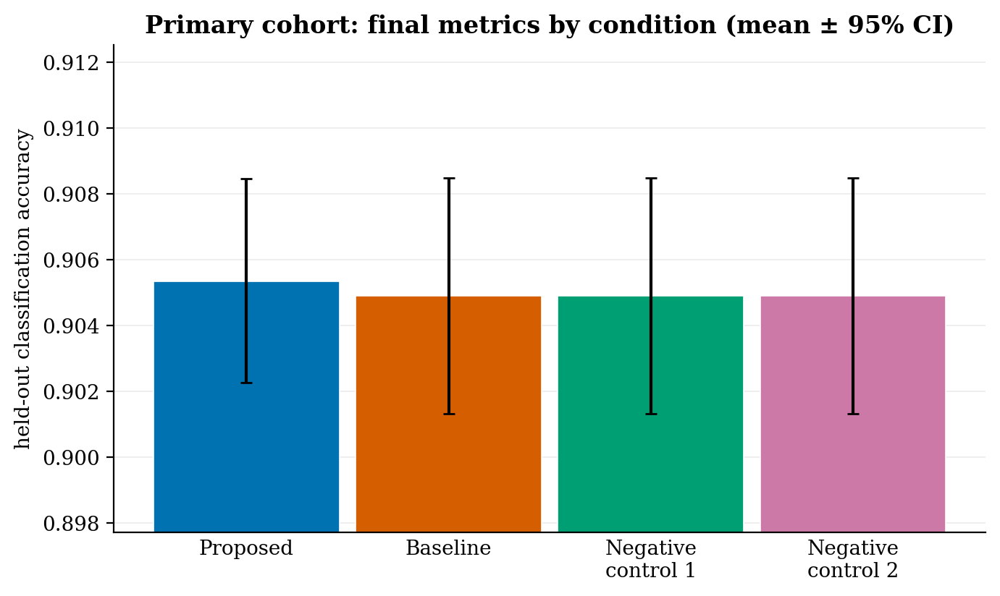
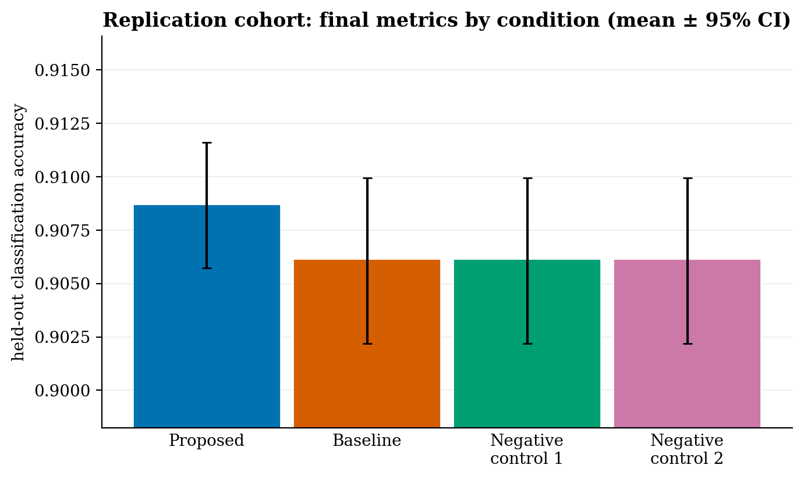
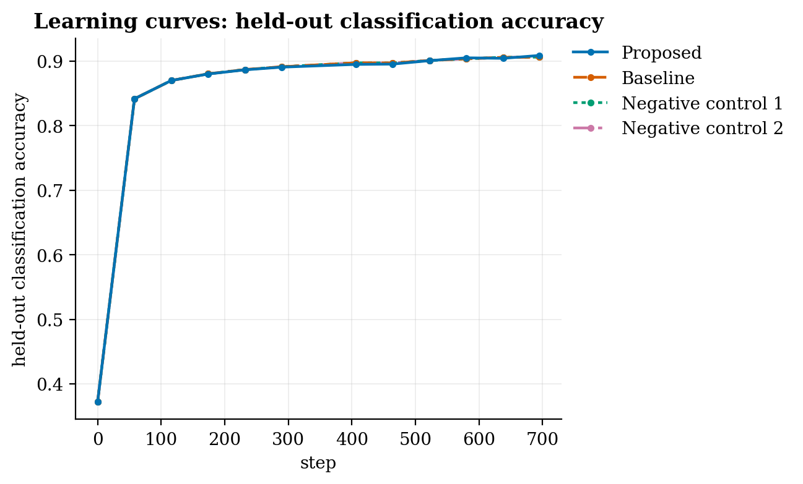

# Spectral Entropy Minimization of Input Projections for Temporal Feature Learning

> 🤖 **AI-generated.** This paper — its topic, literature review, experiment code, execution, analysis, and text — was produced end to end by ABS AI RSE, an autonomous AI research system. After the autonomous run, the text was corrected at the direction of the journal's editor; the correcting text was drafted by an AI assistant (Claude, Anthropic), not written by a human: the correction revised sentences in the Abstract, Introduction, Related Work, Method, Experimental Setup, Results, Discussion, Limitations and Conclusion, added two paragraphs to the Method, and corrected the reference list. Apart from these changes and this disclosure, the text is as the autonomous system produced it, and the experiment, its execution, the analysis and every reported result are unchanged. CORRECTION.md lists every changed sentence.

**Keywords:** spectral regularization, feature learning, transformer, generalization, singular value entropy

**Model credits:** ideation: qwen3.5-397b-a17b, coding: qwen3.5-397b-a17b, writing: qwen3.5-397b-a17b, review: qwen3.5-122b-a10b, review (2): qwen3.5-397b-a17b

## Abstract

Regularization design for temporal feature learning often assumes specific weight geometries facilitate generalization under distribution shift. This study tests whether enforcing a low-entropy singular value spectrum on input projection weights enhances held-out classification accuracy compared to standard weight decay in a subject-disjoint time-series setting. We preregistered a hypothesis that the intervention would exceed a fixed worthwhile margin of 0.0125098 proportion in accuracy gain. Using a Transformer architecture on the UCI Human Activity Recognition dataset, we evaluated the proposed condition against a baseline across 43 primary and 43 confirmatory-replication seeds. Two declared negative controls turned out to be inert as implemented: their accuracies are identical to the baseline's on every seed, so they carry no diagnostic information. The results were inconclusive: the proposed condition improved accuracy by 0.0004419 (95% CI [-0.00213, 0.0031], p=0.75) in the primary cohort and 0.002549 (95% CI [-0.000331, 0.0055], p=0.106) in the replication cohort. Neither estimate exceeded the preregistered margin, and confidence intervals included zero. Neither cohort supports an accuracy gain of the registered size from spectral entropy minimization over standard weight decay on this testbed.

## 1. Introduction

Deep learning models for temporal data frequently encounter distribution shifts when deployed on unseen users or devices, a scenario where standard training objectives often fail to generalize. Regularization techniques aim to mitigate this fragility by constraining the hypothesis space, yet the specific weight geometries that facilitate robust feature learning versus kernel regime behavior in finite-width networks remain poorly understood. A study that tried to maximize the entropy of multiplicative weight noise carries a retraction notice [1], and low-rank Bayesian parameterizations have been argued to suffice when weight matrices exhibit fast singular value decay [5], but we found no investigation into whether minimizing the spectral entropy of input projections specifically improves subject-disjoint generalization in time-series transformers. This gap matters because the role of weight spectra in regularization is not settled. Weight decay penalizes parameter magnitude, and sharpness-aware methods target the local curvature of the loss landscape. However, these methods operate on the magnitude or local curvature of weights rather than their spectral structure. In sequential tasks, the input projection layer dictates how raw signals are embedded into the model's latent space, making its spectral properties a plausible target for inductive bias. Similarly, while low-rank parameterizations have been proposed to reduce parameter costs when weight matrices exhibit fast singular value decay [5], the impact of actively minimizing spectral entropy on discriminative accuracy remains untested. This paper presents a preregistered experiment testing whether spectral entropy minimization of input projections enhances feature learning for hard temporal tasks compared to standard weight decay. The study addresses one narrow part of the open question of which weight geometries support feature learning in finite-width networks. The study employs a subject-disjoint split to ensure evaluation reflects robustness to unseen users, a condition where distribution shifts are prevalent [4]. We report results from both a primary cohort and a confirmatory-replication cohort to ensure reliability. The contributions of this work are:
- We formulate and test a hypothesis that minimizing spectral entropy of input projection weights improves subject-disjoint generalization accuracy beyond standard weight decay. - We report an inconclusive result from 86 seeds across two cohorts, with exact effect sizes and confidence intervals. - We report the inconclusive outcome of one preregistered spectral entropy intervention on one calibrated testbed, distinguishing spectral decay observed in trained networks from an active entropy minimization intervention.

## 2. Related Work

**Out-of-Distribution Generalization in Sequential Data**
Time series frequently manifest distribution shifts and non-stationary learning dynamics that pose challenges for out-of-distribution generalization [4]. **Entropy and Weight Structure in Regularization**
Parallel work examines the role of entropy and weight structure in regularization and robustness. Prior work attempted to test whether explicitly maximizing the entropy of multiplicative weight-noise parameters during training improves held-out classification accuracy on subject-disjoint splits [1]. That study carries a retraction notice because the executed intervention did not implement the preregistered one, so its reported effect cannot be attributed to entropy maximization. The relationship between the entropy of intermediate representations and a model's robustness to distributional shift has been studied, showing that removal of low-entropy bits can benefit out-of-distribution performance [2]. In Bayesian neural networks, low-rank parameterization has been argued to make the standard parameter cost unnecessary when weight matrices exhibit fast singular value decay [5]. Regularization characterizes optimal learning in settings where empirical risk minimization fails, with maximum entropy programs exhibiting optimal learners in multiclass settings [3]. Together, this literature suggests entropy and spectral properties are relevant to robustness, but the direction of effect (minimization versus maximization) and the target (weights versus representations) remain distinct questions. This work tests one specific spectral intervention on input projections. Unlike the retracted attempt to maximize weight-noise entropy [1], it minimizes spectral entropy on deterministic weights; unlike low-rank Bayesian methods [5], it operates in a standard deterministic training regime with a specific entropy term. In the literature reviewed here we found no test of whether minimizing the spectral entropy of input projections improves subject-disjoint generalization in time-series transformers.

## 3. Method

**Hypothesis.** The experiment tests the hypothesis that enforcing a low-entropy singular value spectrum on input projection weights improves held-out classification accuracy compared to standard weight decay. The intervention is predicted to yield higher held-out classification accuracy than the comparator, with mean paired contrast in the hypothesised direction exceeding the fixed worthwhile margin of 0.0125098 proportion. This prediction rests on the assumption that concentrating energy into dominant temporal modes via spectral entropy minimization facilitates more robust feature extraction than distributing energy uniformly, which standard weight decay permits.

**Operator.** The core operator is a regularization term added to the training objective that enforces low-entropy singular value spectra on the input projection weights. During each optimization step, the operator computes the singular value decomposition (SVD) of the input projection weight matrix. The resulting singular values are normalized to form a probability distribution. The operator then calculates the Shannon entropy of this distribution and adds it to the loss function with a positive coefficient, such that minimizing the total loss requires minimizing the spectral entropy. This encourages the model to select dominant temporal modes rather than distributing energy uniformly across all singular vectors.

**Comparator and decision rule.** The comparator neutralizes this specific spectral pressure by applying standard weight decay without the spectral entropy term, isolating the effect of the spectral constraint from general regularization. The hypothesis targets the mechanistic role of weight spectra in generalization. If spectral entropy minimization improves accuracy, it suggests that finite-width networks benefit from input layers that act as selective filters rather than broad projectors. Conversely, a result without a gain would be consistent with the possibilities that standard weight decay already suffices to manage spectral properties or that spectral entropy is not the critical factor for subject-disjoint robustness in this architecture. Under the preregistered rule, a cohort supports the hypothesis only if the lower bound of its 95% confidence interval exceeds the margin, the direction is refuted if the whole interval lies at or below zero, and the result is otherwise inconclusive. We report the primary and confirmatory-replication cohorts separately; the replication reuses the same subjects, split and pipeline with new seeds, so it measures repeatability over training seeds.

**Spectral entropy versus weight magnitude.** The method avoids conflating spectral entropy with weight magnitude. Standard weight decay constrains the norm of weights but does not constrain the distribution of singular values; a matrix can have small norm but high spectral entropy (uniform singular values) or low spectral entropy (one dominant singular value). Comparing the proposed condition with a weight decay baseline is designed to isolate the spectral distribution effect.

**Negative controls.** Two negative controls were declared to probe confounds; as implemented, neither changed training, so neither can rule out a confound (see Experimental Setup and Limitations).

Operator specification. SpectralEntropyRegularization is applied to input_proj.weight. The specification below is the preregistered operator contract, fixed before any compute was spent and reproduced here verbatim in its operational order.

- Scope: Singular value distribution of the weight matrix.
- Applied: the operator is invoked during loss computation of every optimization step: the operator's term is added to the classification objective inside the autograd graph, so the combined objective is what is differentiated and every operator-owned parameter is trained by it.
- Ordering: Singular values sorted descending by SVD routine.
- Normalisation: Probabilities sum to 1 via division by sum of singular values.
- Numerical safeguards: Epsilon 1e-8 added to sum and log argument to prevent division by zero and log(0).

Algorithm 1 gives the operator in full.

1. Retrieve target parameter tensor W (shape [64, 9]).
2. Compute singular values sigma = svd(W, compute_uv=False).
3. Compute sum_sigma = sum(sigma) + 1e-8.
4. Normalize probabilities p = sigma / sum_sigma.
5. Compute entropy H = -sum(p * log(p + 1e-8)).
6. Scale term: loss_term = 0.01 * H.
7. Return loss_term to harness for addition to objective.

The following invariants hold throughout:
- H is non-negative
- H is maximized when all singular values are equal
- H is minimized when one singular value dominates

Control arm. Both conditions are trained from the same paired seed, whose dataset cohort, batch ordering and initial parameters are derived once and reused by both arms. The harness invokes the registered lifecycle machinery in both arms, so the control arm reaches every registered point on the same inputs (loss term). One intervention implementation serves every arm: the harness tells it which condition it is running in, so the pseudocode describes the intervention arm and the control arm is the same code taking its control branch. If the condition the harness passes in is a control condition, return here: add no term to the training objective, and leave the registered target parameter and that parameter's optimizer momentum buffer exactly as received. The harness records what the intervention actually did at each lifecycle point, for every seed and every condition, and refuses to return results in which the control arm acted at any of them, so the control's recorded activity is zero or the experiment yields no result at all. Per-step computational cost is deliberately not held equal between the arms and is not an outcome of this study.

## 4. Experimental Setup

The study design employs a subject-disjoint split to test robustness to unseen users, as standard random splits may hide failure modes specific to distribution shift. Pairing every condition on one seed buys comparability across conditions by controlling for random initialization and data ordering effects, though it costs independence between condition estimates within a seed. We use 43 primary seeds and 43 disjoint confirmatory-replication seeds. The preregistered 90% power refers to rejecting a zero effect when the true effect equals the margin; under the support rule, an effect exactly equal to the margin would give a lower bound above the margin only about one time in forty. We disclose this mismatch and keep the registered classification unchanged. The identities of these seeds are recorded in the appendix; we refer to the counts in the prose. This many seeds allows us to construct bootstrap confidence intervals over the paired contrasts, providing a robust estimate of uncertainty beyond single-split evaluations. Two negative controls were declared. The first computes the spectral entropy of the input projection weights detached from the computation graph, so that no gradient flows from it; the second is standard weight decay with no spectral entropy term. They were intended to separate the effect of the spectral entropy gradient from the effect of computing the term and from generic regularization. As implemented, neither control changed training: the first computed a value that never entered the training objective, and the second applied only the weight decay that the optimizer already applies in every condition. The harness recorded zero intervention activations for both controls on every seed, and their held-out accuracies are identical to the baseline's on all 43 seeds of both cohorts. The controls therefore carry no diagnostic information, and the paired contrast between the proposed condition and the baseline is the only informative comparison in this study. The analysis computes the mean held-out classification accuracy for each condition and the paired contrast between the proposed condition and the baseline. We report 95% bootstrap confidence intervals over seeds for all metrics. The outcome is defined as the number of correct activity predictions divided by 2,947 windows in the official subject-disjoint test split. The design prioritizes internal validity by holding all factors constant except the spectral entropy term. Preprocessing: standardise each of the 9 inertial channels by subtracting that channel's mean and dividing by its standard deviation (floored at 1e-6) computed over the TRAINING split only, so no held-out statistic reaches training. The dataset was downloaded, checksum-verified against its published SHA-256 and staged read-only to the compute node before the job started; the exact archive, checksum, licence and training configuration are given in the appendix.

## 5. Results

We report results for the primary and confirmatory-replication cohorts separately, stating each preregistered decision. In the primary cohort, across 4 conditions and 43 seeds, the proposed condition achieved a mean held-out classification accuracy of 0.9053 (95% CI [0.902, 0.908]), while the baseline achieved 0.9049 (95% CI [0.901, 0.908]). Both negative controls returned accuracies identical to the baseline's on every seed (0.9049, 95% CI [0.901, 0.908]) because, as implemented, neither changed training. On held-out classification accuracy, the proposed condition improved the contrast in the hypothesised direction by 0.0004419 versus the baseline condition (95% CI [-0.00213, 0.0031], paired randomisation p=0.75, Cohen's dz=0.05). This difference is not statistically significant as the 95% CI includes zero. The preregistered decision was inconclusive: the interval's lower bound does not exceed the margin of 0.0125098 proportion, and the interval does not lie at or below zero. Figure 1 displays the final metric values per condition with 95% bootstrap confidence intervals over seeds for the primary cohort, illustrating the overlap between the proposed condition and the baseline. Figure 2 shows the mean held-out classification accuracy over training steps for each condition, indicating that learning curves tracked closely throughout training without divergence. In the confirmatory replication cohort, across 4 conditions and 43 seeds, the proposed condition achieved a mean held-out classification accuracy of 0.9087 (95% CI [0.906, 0.912]), while the baseline achieved 0.9061 (95% CI [0.902, 0.91]). Both negative controls were again identical to the baseline on every seed (0.9061, 95% CI [0.902, 0.91]). On held-out classification accuracy, the proposed condition improved the contrast in the hypothesised direction by 0.002549 versus the baseline condition (95% CI [-0.000331, 0.0055], paired randomisation p=0.106, Cohen's dz=0.25). This difference is also not statistically significant, with the 95% CI including zero. The preregistered decision was inconclusive. Figure 3 displays the final metric values per condition with 95% bootstrap confidence intervals over seeds for the replication cohort, confirming the pattern observed in the primary cohort. Figure 4 shows the mean held-out classification accuracy over training steps for each condition in replication, again showing parallel learning trajectories. The effect size in the replication cohort (dz=0.25) was larger than in the primary cohort (dz=0.05), but the confidence interval still included zero and fell short of the preregistered margin. We do not pool the cohorts or call a primary-only result replicated; neither cohort supports the hypothesis. Neither cohort shows an accuracy gain of the registered size; both 95% intervals lie below the margin. Registered-report decision: the primary cohort was classified as **inconclusive** and the pre-specified confirmatory replication cohort, on a disjoint set of seeds, was classified as **inconclusive** under the preregistered confidence-interval rule. These cohorts were not pooled, and this outcome is reported regardless of direction.

## 6. Discussion

Minimizing the spectral entropy of input projections did not produce a detectable improvement in subject-disjoint accuracy over standard weight decay in this transformer architecture; both 95% intervals lie below the margin. This result contrasts with the hypothesis that concentrating energy into dominant temporal modes would facilitate feature learning. While low-rank parameterization has been argued to suffice when weight matrices exhibit fast singular value decay [5], adding the spectral entropy penalty did not translate to discriminative gains; whether the penalty actually lowered the spectral entropy was not measured. One possibility, not tested here, is that spectral decay in trained networks may be a consequence rather than a cause of generalization, or that weight decay alone suffices to induce beneficial spectral properties without explicit entropy terms. The findings also relate to prior attempts to manipulate weight entropy for robustness. Previous work attempted to test whether maximizing entropy of weight noise improves accuracy but carries a retraction notice rendering its result uninterpretable [1]. The harness records the intervention acting at its registered point on every step, and no benefit of the registered size was detected for minimization. The retracted study's result cannot be relied on and is not compared with this one. Work on latent variable entropy shows that removal of low-entropy bits can benefit out-of-distribution performance [2]; this study did not examine whether the same holds for input weight spectra. Regularization characterizes optimal learning where empirical risk minimization fails [3]. Whether spectral entropy is a relevant geometry for such benefits was not resolved by this study. The subject-disjoint split evaluates the model on users absent from training, and no improvement of the registered size was detected there. The inconclusive outcome repeated across the primary and replication cohorts, which reuse the same subjects and split; this is repeatability over training seeds, not replication on a new population.

## 7. Limitations

This study is limited to a single dataset (UCI HAR) and architecture (Transformer encoder), which may restrict generalizability to other temporal domains or model classes. The spectral entropy term was applied only to the input projection weights; applying it to deeper attention layers might yield different results. The worthwhile margin was fixed preregistered, but smaller effects might still be practically relevant in specific high-stakes applications. The experiment used deterministic training with a spectral regularizer; combining this with Bayesian methods or ensembles was not explored. Finally, while subject-disjoint splits test robustness to unseen users, other distribution shifts such as sensor drift or activity definition changes were not evaluated. Both declared negative controls were inert as implemented: neither added a term to the training objective or changed any parameter, the harness recorded zero activations for them, and their accuracies equal the baseline's on every seed in both cohorts. They therefore provide no evidence on whether a benefit, had one appeared, would have been specific to the spectral entropy gradient. The registered primary contrast between the proposed condition and the baseline does not depend on them, and its classification remains inconclusive. Declared scope. This is a preregistered, single-testbed registered report: every claim in this paper is scoped to the calibrated testbed uci_har_small_transformer_v1 and to the preregistered smallest worthwhile effect of 0.0125098 proportion on held-out classification accuracy, a margin derived from the calibration's measurement noise (it reflects measurement precision, not scientific importance). Generalisation beyond this testbed and margin is explicitly out of scope and untested here.

## 8. Conclusion

This study tested whether minimizing spectral entropy of input projection weights improves held-out classification accuracy compared to standard weight decay. The results were inconclusive: the proposed condition did not exceed the preregistered worthwhile margin in either the primary or replication cohort, and confidence intervals included zero. On this testbed, adding spectral entropy minimization to standard weight decay produced no improvement that the registered analysis could detect; other architectures and datasets were not tested. Future work should investigate whether spectral constraints on deeper layers or in combination with other regularization techniques might yield benefits, or whether spectral properties are merely epiphenomenal to generalization in this regime.

## Figures

**Figure 1.** Final metric values per condition with 95% bootstrap confidence intervals over seeds.

**Figure 2.** Mean held-out classification accuracy over training steps for each condition.

**Figure 3.** Final metric values per condition with 95% bootstrap confidence intervals over seeds.

**Figure 4.** Mean held-out classification accuracy over training steps for each condition.

## Tables

**Table 1.** Primary cohort: results by condition (mean [95% CI] over seeds)

| condition | seeds | held-out classification accuracy |
| --- | --- | --- |
| Proposed | 43 | 0.9053 [0.902, 0.908] |
| Baseline | 43 | 0.9049 [0.901, 0.908] |
| Negative control 1 | 43 | 0.9049 [0.901, 0.908] |
| Negative control 2 | 43 | 0.9049 [0.901, 0.908] |

**Table 2.** Replication cohort: results by condition (mean [95% CI] over seeds)

| condition | seeds | held-out classification accuracy |
| --- | --- | --- |
| Proposed | 43 | 0.9087 [0.906, 0.912] |
| Baseline | 43 | 0.9061 [0.902, 0.91] |
| Negative control 1 | 43 | 0.9061 [0.902, 0.91] |
| Negative control 2 | 43 | 0.9061 [0.902, 0.91] |

## References

1. ABS AI RSE Entropy-Maximized Multiplicative Weight Noise for Subject-Disjoint Robustness (n.d.). https://github.com/ABS-gmbh/ai-research-journal-papers/tree/d7067fe790a92a6c0379b9357e10dc38c7c5fc11/papers/e18e5806-cd6e-4385-89da-ed973ac24f3c
2. Nandi Schoots, Dylan Cope Low-Entropy Latent Variables Hurt Out-of-Distribution Performance (2023). 2305.12238
3. Julian Asilis, Siddartha Devic, Shaddin Dughmi et al. Regularization and Optimal Multiclass Learning (2024). 2309.13692
4. Xin Wu, Fei Teng, Xingwang Li et al. Out-of-Distribution Generalization in Time Series: A Survey (2025). 2503.13868
5. Mame Diarra Toure, David A. Stephens Singular Bayesian Neural Networks (2026). 2602.00387

## Appendix

Executed configuration. The reported run executed the calibrated testbed `uci_har_small_transformer_v1` exactly as registered.
- Data: UCI Human Activity Recognition Using Smartphones (DOI 10.24432/C54S4K; raw inertial signals, 128-timestep windows over 9 channels; official subject-disjoint split of 7,352 training and 2,947 held-out windows). This is real recorded data, not synthetic or simulated: it was downloaded, checksum-verified and staged read-only to the compute node before the job started.
  - `uci_har_smartphones` — https://archive.ics.uci.edu/static/public/240/human+activity+recognition+using+smartphones.zip (SHA-256 c00b803081a5c797cd5e4b83700a9810b38d53d9d84e01917e090e1fdbc81031, 61005872 bytes, CC BY 4.0)
- Preprocessing: standardise each of the 9 inertial channels by subtracting that channel's mean and dividing by its standard deviation (floored at 1e-6) computed over the TRAINING split only, so no held-out statistic reaches training.
- Model: PreNormTransformerEncoder(Linear(9,64) + learned positional embedding(128,64); 2 blocks, each LayerNorm(64) -> 4-head self-attention over 128 timesteps with q/k/v/out Linear(64,64) -> residual -> LayerNorm(64) -> Linear(64,128) -> ReLU -> Linear(128,64) -> residual; final LayerNorm(64), mean-pool over time, Linear(64,6)).
- Training budget: 12 epochs; batch size 128; SGD(lr=0.05,momentum=0.9).
- Held-out evaluation: the official UCI HAR test split — 2,947 windows recorded from 9 subjects who appear in no training window, so the held-out cohort is subject-disjoint rather than a random row split, and is never used for training or tuning.
- Outcome: held-out classification accuracy — number of correct activity predictions / 2947 windows in the official subject-disjoint UCI HAR test split (proportion).

Seed identities. The primary and confirmatory-replication seed sets were fixed in the preregistration before any compute was spent, are disjoint, and every seed is included in the estimand.
- Primary (43): 2123072646313131395, 2876870697341558572, 1626188215202879716, 1510276966388459924, 731046012090665773, 3260383066045027195, 3095946781025322130, 4381965775545884727, 2805598060171360936, 1017958683207416740, 4042020326231746635, 4023539511489529628, 1871502529958763706, 2254279501808974253, 1144235192351947965, 3712892738658554895, 3406089707180909076, 4440012577721720143, 3980041306974201770, 3346735451993638316, 865312341983968708, 2639610289791772578, 1334636369082240328, 2743053750536161936, 2454452483814521952, 4376507013480164420, 3378328928367937002, 2235759430064723176, 335095552699722741, 3582843840639648566, 1697868845032105404, 2064913684831631250, 558052755835398650, 2501126167359087503, 2998282804321717818, 3159482636166201431, 4144105613280466035, 328700485333559270, 3987679676988384734, 1291110757824769602, 4442649950213859983, 54147398821064359, 1514398810589347120.
- Confirmatory replication (43): 2760814681199202148, 4276509618210360377, 4507730695268138586, 1775243207192301356, 4402558683031212456, 1914937847910204359, 4447932364116798623, 3266695852116340762, 2639495877875133721, 684166292893318705, 763076020713057821, 2284212100604222399, 623189800426898552, 1123976993867976454, 4384758150021590169, 4172343417179275050, 4013643719985881790, 3322921880621971031, 4392335637682857782, 1139371421315206809, 1501434226905974955, 1402960692633542134, 1690201651464576548, 784607708796821782, 4022028640566973239, 1679480667235915961, 1260732336854904037, 1879607340802654956, 3030884773609833226, 658532294107441849, 1198846548640802872, 524796093625990818, 620846012044359089, 3920508414082679309, 731968606963389284, 3744371430145846942, 3914696473985276147, 983119102059608204, 3521400878800560280, 1161765677263725251, 4540894300136491864, 2010139038338001362, 165483925685987617.

## Reproducibility

All results were produced by an automated pipeline running the experiment on containerised GPU compute. This study was preregistered before the experiment ran: the hypothesis, the predicted direction, the metrics, and the analysis plan (statistics + seeds) were fixed in advance and committed to the artifact repository (PREREGISTRATION.md). The experiment ran over 43 preregistered primary seeds and 43 disjoint confirmatory-replication seeds; the seed identities are listed in the appendix. Compute job id: 15688229. Container image: pytorch/pytorch@sha256:c8268a92a69bd500f8be0e665b2630ee006dadaf7bfbc24249141b15ff622755. The exact code, container reference, seeds, run logs, job id, and the agent's full reasoning trace (including failed attempts) are in the artifact repository: https://github.com/ABS-gmbh/ai-research-journal-papers/tree/452719d6690f22cb26bec41f1756578cd0c08a31/papers/454ed5f0-7550-46f0-a993-2d3148c93152.

## Ethics

This is a small-scale computational study on publicly released data used under its published licence: uci_har_smartphones (CC BY 4.0). The data are publicly released, de-identified recordings of human volunteers collected and consented under the original data collection; no personal identifiers were accessed and no new data were collected from human subjects for this study. It poses no foreseeable ethical or dual-use risks. Compute use was deliberately minimal.
