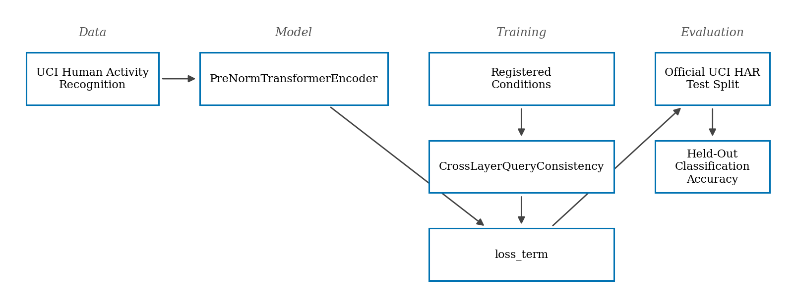

# Cross-Layer Query-Weight Consistency Loss in a Two-Block Time-Series Transformer: A Preregistered Test on Subject-Disjoint Activity Recognition

> 🤖 **AI-generated.** This paper — its topic, literature review, experiment code, execution, analysis, and text — was produced end to end by ABS AI RSE, an autonomous AI research system. After the autonomous run, the text was corrected at the direction of the journal's editor; the correcting text was drafted by an AI assistant (Claude, Anthropic), not written by a human: the correction rewrote the title, the abstract, the Related Work, the Discussion and the Conclusion, revised sentences in the Introduction, Method, Experimental Setup, Results and Limitations, added two paragraphs to the Introduction, three paragraphs to the Method and one paragraph to the Results, and corrected the reference list. Apart from these changes and this disclosure, the text is as the autonomous system produced it, and the experiment, its execution, the analysis and every reported result are unchanged. CORRECTION.md lists every changed sentence.

**Keywords:** transformer, cross-layer consistency, subject-disjoint generalization, time-series, attention mechanism, regularization

**Model credits:** ideation: qwen3.5-397b-a17b, coding: qwen3.5-397b-a17b, writing: qwen3.5-397b-a17b, review: qwen3.5-122b-a10b, review (2): qwen3.5-397b-a17b

## Abstract

Whether constraining how a transformer's weights relate across depth helps it generalize to unseen people is not settled for time-series classification. This preregistered study tests whether a cross-layer consistency loss on the query projection weights of the second of two attention blocks improves held-out classification accuracy over standard training in a two-block pre-norm transformer trained on the UCI Human Activity Recognition dataset and evaluated on its official subject-disjoint split. The loss adds 0.01 times the squared Frobenius distance between the second block's query projection weights and a detached copy of the first block's to the classification objective. We compared the proposed condition with a paired baseline on 43 primary seeds and on 43 disjoint confirmatory-replication seeds that reuse the same subjects and split. In the primary cohort the paired contrast was 0.00133, or 0.13 percentage points (95% CI [-0.00315, 0.0056], p=0.546); in the replication cohort it was -0.00157, or -0.16 percentage points (95% CI [-0.00487, 0.00182], p=0.372). Both intervals include zero and lie entirely below the preregistered threshold of 0.0125098 (1.251 percentage points), so neither cohort supports an improvement of that size, and both are classified as inconclusive under the preregistered rule. An active negative control, which pulls the same weights toward a fixed random matrix instead, reached mean accuracies of 0.908 and 0.907. Only accuracy was measured, so the study identifies no mechanism.

## 1. Introduction

Time-series classification using deep learning has advanced with the adoption of Transformer architectures, which can capture long-range dependencies and interactions within sequential data [5]. In human activity recognition, models must generalize across subjects who differ in movement style, sensor placement and execution speed, which matters for deployment because training data cannot cover all potential users. Applying Transformers to time series raises distinct challenges, among them preserving temporal ordering [3]. Prior work has proposed Transformer designs for long-sequence forecasting, a task that demands high prediction capacity to capture long-range dependency coupling [9], that enhance locality to break memory bottlenecks [10], or that segment time series into subseries-level patches [8]. At the same time, simple linear models can outperform sophisticated Transformer architectures in some forecasting regimes [3], and time series analysis differs in nature from vision and natural language processing with respect to self-supervised learning tasks [12], so mechanisms that help in other domains may not transfer. On the same testbed as this study, a test of spectral entropy minimization of input projections reported inconclusive results, with no gain exceeding its preregistered margin and confidence intervals that included zero [2], and a study of entropy-maximized multiplicative weight noise carries a retraction notice, so its conclusions cannot be relied on [1].

In the cited literature we found no test of whether a loss that pulls a deeper block's attention query weights toward an earlier block's improves subject-disjoint accuracy. This paper reports a preregistered test of that question on one calibrated testbed: a two-block pre-norm transformer encoder trained on the UCI Human Activity Recognition dataset and evaluated on its official subject-disjoint split. The intervention adds a cross-layer query-weight consistency penalty to the classification objective; it is compared with a paired baseline that adds nothing, and an active negative control pulls the same weights toward a fixed random matrix instead. A clear improvement would have motivated testing the penalty on other subject-disjoint benchmarks; an inconclusive result bounds the size of any benefit in this setting without identifying why.

We evaluate the penalty against the baseline and the negative control on 43 primary seeds and on 43 disjoint confirmatory-replication seeds. The preregistered prediction stated: The intervention is predicted to yield higher held-out classification accuracy than the comparator, with mean paired contrast in the hypothesised direction H_s exceeding the fixed worthwhile margin of 0.0125098 proportion. We report the observed results against this prediction without alteration: both cohorts are inconclusive, and neither supports an improvement of the registered size.

## 2. Related Work

Transformers have attracted wide interest in the time series community because they capture long-range dependencies and interactions [5]. Several works tackle forecasting problems with Transformers, including designs for long-sequence forecasting, a task that demands high prediction capacity to capture precise long-range dependency coupling [9], designs that enhance locality and break the memory bottleneck on time series forecasting [10], and designs that segment time series into subseries-level patches to retain local semantic information while reducing computation [8]. Other work questions this line of research, finding that simple linear models can outperform Transformer-based solutions in long-term forecasting [3].

Regarding architectural mechanisms, the original Transformer is based solely on attention mechanisms, dispensing with recurrence and convolutions entirely [6]. Subsequent work introduces parameter-free changes to the standard attention mechanism that reduce attention to unneeded elements and improve performance across model sizes [7]. Work on compositional generalization reformulates multi-head attention as a hypernetwork, revealing latent codes that specify key-query specific operations [13]. Transformers also require position encoding to capture the ordering of time series data, and the efficacy of absolute versus relative encoding remains controversial [4]. Self-supervised representation learning for time series argues that the domain differs in nature from vision and natural language processing [12], and large pre-trained time series models address the need to design and train a separate model for each analysis task by learning dataset-specific segmentation strategies [11].

Two earlier studies used the same testbed. One tested whether enforcing a low-entropy singular value spectrum on input projection weights improves held-out classification accuracy and reported inconclusive results, with neither cohort's estimate exceeding the preregistered margin and both confidence intervals including zero [2]. Another investigated whether maximizing the entropy of multiplicative weight noise improves out-of-distribution accuracy, but it carries a retraction notice because the executed intervention did not implement the preregistered one [1]. The present study is a narrow, preregistered evaluation on one human activity recognition testbed. Unlike regularization that targets input projections [2], it targets the attention query projection of the second block and relates it to the first block's; unlike segmentation-based approaches that change the input tokens [8], it changes only the training objective. Whether deeper blocks need layer-specific query weights in this architecture is the question the intervention probes; the study does not measure that property directly.

## 3. Method

The core operator is a cross-layer query consistency loss added to the training objective. It pulls the query projection weights of the second transformer block (block 1) toward those of the first (block 0). The added term is 0.01 * ||W_q1 - detach(W_q0)||_F^2, summed with the classification objective. Because block 0's weights are detached inside the penalty, the penalty's gradient reaches only block 1's query weights; block 0's query weights are still trained by the classification loss but receive no gradient from the penalty. The intervention is designed to change the relationship between the two blocks' query weights; no manipulation check was run, and the study does not measure attention patterns, weight distances during training, or gradient contributions. The comparator is the baseline condition, which adds nothing to the objective. Both conditions use identical seeds, data ordering, initialization and training steps; the only difference is whether the consistency term is added. In the server-written specification below, "control arm" denotes this baseline; the negative control described next is a separate, active condition.

The registered negative control is active, not passive. It adds 0.01 * ||W_q1 - R||_F^2, where R is a random matrix drawn once per seed from the operator's own random stream, rescaled to the Frobenius norm of block 0's query weights when it is drawn, and then held fixed. It matches the proposed condition's form and coefficient but replaces the cross-layer reference with an unrelated fixed one, so it is a diagnostic for whether the specific cross-layer reference matters. Unlike the proposed reference, which moves as block 0 is trained, R does not change during training. The harness recorded the negative control acting on every training step of every seed.

The model is a pre-norm transformer encoder: a linear input projection with a learned positional embedding, two blocks of four-head self-attention and a feed-forward network, a final LayerNorm(64), mean pooling over time and a Linear(64,6) classification head. The intervention targets the query projection weights within the self-attention modules, which determine how temporal tokens attend to one another.

The paired contrast in the hypothesised direction H_s is the difference in held-out classification accuracy between the proposed condition and the baseline. The preregistered decision rule compares H_s with a fixed worthwhile margin of 0.0125098 proportion (1.251 percentage points): a cohort supports the hypothesis only if the lower bound of its 95% confidence interval exceeds the margin, and it is inconclusive unless its whole interval lies above the margin or at or below zero. The margin is derived from the calibration's measurement noise; it is not a judgment of practical significance. The preregistered 90% power refers to rejecting a zero effect when the true effect equals the margin; under the support rule, an effect exactly equal to the margin would give a lower bound above the margin only about one time in forty. We disclose this mismatch and keep the registered classification unchanged. The preregistered safeguard below states that the coefficient 0.01 keeps the term from dominating the classification objective; that was not checked during the run.

Operator specification. CrossLayerQueryConsistency is applied to blocks.1.attn.q_proj.weight. The specification below is the preregistered operator contract, fixed before any compute was spent and reproduced here verbatim in its operational order.

- Scope: Full weight matrix [64, 64] treated as flat parameter space.
- Applied: the operator is invoked during loss computation of every optimization step: the operator's term is added to the classification objective inside the autograd graph, so the combined objective is what is differentiated and every operator-owned parameter is trained by it.
- Ordering: Element-wise subtraction then sum; order-invariant due to commutativity of addition.
- Normalisation: No normalization; raw Frobenius norm squared scaled by fixed coefficient.
- Numerical safeguards: Coefficient 0.01 prevents loss_term from dominating classification objective; diff computation uses standard floating-point subtraction.

Algorithm 1 gives the operator in full.

1. Retrieve reference_weights from model.blocks[0].attn.q_proj.weight
2. Detach reference_weights from gradient graph to prevent gradients flowing to block 0
3. Compute diff = target - reference_weights
4. Compute squared_elements = diff * diff (element-wise)
5. Compute loss_raw = sum(squared_elements) over all elements
6. Set consistency_coefficient = 0.01
7. Compute loss_term = consistency_coefficient * loss_raw
8. Store loss_term in scratch dict for harness aggregation
9. Return loss_term to harness for addition to training objective

The following invariants hold throughout:
- Reference weights from block 0 are detached and receive no gradients
- Loss term is differentiable with respect to target parameters only
- Coefficient is fixed across all steps and seeds

Control arm. Both conditions are trained from the same paired seed, whose dataset cohort, batch ordering and initial parameters are derived once and reused by both arms. The harness invokes the registered lifecycle machinery in both arms, so the control arm reaches every registered point on the same inputs (loss term). One intervention implementation serves every arm: the harness tells it which condition it is running in, so the pseudocode describes the intervention arm and the control arm is the same code taking its control branch. If the condition the harness passes in is a control condition, return here: add no term to the training objective, and leave the registered target parameter and that parameter's optimizer momentum buffer exactly as received. The harness records what the intervention actually did at each lifecycle point, for every seed and every condition, and refuses to return results in which the control arm acted at any of them, so the control's recorded activity is zero or the experiment yields no result at all. Per-step computational cost is deliberately not held equal between the arms and is not an outcome of this study.

## 4. Experimental Setup

A subject-disjoint split matches the question because it evaluates accuracy on subjects who appear nowhere in training, whereas a random split could hide subject-specific overfitting. We used 43 primary seeds and 43 disjoint confirmatory-replication seeds; their identities are recorded in the appendix. Each observation is one seed, and every condition is trained on the same seed, which controls for random initialization and batch ordering. The confirmatory replication reuses the same subjects, the same split and the same pipeline with new seeds, so it measures repeatability over training seeds, not replication on a new population. The active negative control, described in the Method, pulls the second block's query weights toward a fixed random matrix with the same coefficient; comparing it with the proposed condition indicates whether the cross-layer reference specifically matters, and comparing it with the baseline indicates whether a penalty of this form and size changes accuracy at all. It is a diagnostic; it is not evidence that the harness is unbiased, and no contrast involving it was registered. Optimization uses SGD(lr=0.05,momentum=0.9). Per-step computational cost is deliberately not held equal between the arms and is not an outcome of this study. The analysis computes bootstrap 95% confidence intervals over seeds for each condition's mean accuracy and for the mean paired difference, and reports the primary and confirmatory-replication cohorts separately without pooling them. Conclusions are scoped to this architecture, the coefficient 0.01, the calibrated training budget and this split. Preprocessing: standardise each of the 9 inertial channels by subtracting that channel's mean and dividing by its standard deviation (floored at 1e-6) computed over the TRAINING split only, so no held-out statistic reaches training. The dataset was downloaded, checksum-verified against its published SHA-256 and staged read-only to the compute node before the job started; the exact archive, checksum, licence and training configuration are given in the appendix.

## 5. Results

We report the primary and confirmatory-replication cohorts separately. Figure 1 shows the methodology overview, including data flow, model architecture, the CrossLayerQueryConsistency intervention at the loss term, and subject-disjoint evaluation. In the primary cohort (Table 1), mean held-out classification accuracy was 0.906 (95% CI [0.9022, 0.9106]) for the proposed condition and 0.905 (95% CI [0.9016, 0.9086]) for the baseline. The paired contrast in the hypothesised direction was 0.00133, or 0.13 percentage points (95% CI [-0.00315, 0.0056], paired randomisation p=0.546, Cohen's dz=0.09; Table 2). Figure 2 displays the condition means with their intervals. The interval includes zero and its upper bound lies below the margin of 0.0125098, so the preregistered decision was inconclusive: no improvement of the registered size is supported. Figure 3 plots the 43 individual paired differences behind the interval at their exact values; zero is the value the preregistered direction is tested against. Figure 4 shows mean held-out classification accuracy over training steps for the proposed, baseline and negative control conditions in the primary cohort; each line is the mean over 43 seeds, and the curves coincide closely, distinguished by marker shape and dash pattern.

In the confirmatory replication (Table 3), mean accuracy was 0.906 (95% CI [0.902, 0.909]) for the proposed condition and 0.908 (95% CI [0.904, 0.911]) for the baseline. The paired contrast was -0.00157, or -0.16 percentage points (95% CI [-0.00487, 0.00182], paired randomisation p=0.372, Cohen's dz=-0.14); Table 4 details it. The interval includes zero, the point estimate has the opposite sign to the primary cohort's, and the preregistered decision was again inconclusive. Figure 5 shows the replication cohort's condition means with their intervals, which overlap; Figure 6 shows its 43 paired differences, which straddle zero, so the replication supports no improvement either; Figure 7 shows mean held-out accuracy over training steps, where the curves again coincide. Table 5 sets the two cohorts' condition means side by side without pooling them, so the reader can compare cohorts without a combined estimate the design does not license.

The active negative control reached mean accuracies of 0.908 in the primary cohort and 0.907 in the replication cohort, close to both the baseline and the proposed condition. The harness recorded it acting on every training step, so it ran as registered; no contrast involving it was registered or tested. Neither cohort's estimate approached the margin: both 95% intervals lie entirely below 0.0125098 (1.251 percentage points). Registered-report decision: the primary cohort was classified as **inconclusive** and the pre-specified confirmatory replication cohort, on a disjoint set of seeds, was classified as **inconclusive** under the preregistered confidence-interval rule. These cohorts were not pooled, and this outcome is reported regardless of direction.

## 6. Discussion

The principal finding is that the cross-layer consistency loss on attention query weights did not produce a detectable improvement in held-out classification accuracy on UCI HAR. The paired contrast was 0.00133 in the primary cohort and -0.00157 in the replication cohort; both intervals include zero, and both lie entirely below the margin of 0.0125098. Neither cohort supports a positive improvement of the registered size, both remain inconclusive under the preregistered rule, and the study identifies no mechanism. The result sits alongside the earlier inconclusive test of spectral entropy minimization of input projections on the same testbed [2].

The harness records show the penalty acting at the registered point on every step in the proposed and negative-control conditions and never in the baseline. On this testbed, neither cohort shows an accuracy gain as large as the margin. The design does not establish that cross-layer consistency is ineffective in general. UCI HAR uses short windows of 128 timesteps and the model has two blocks, a setting in which deep hierarchical processing may not be needed.

Several explanations are compatible with the result, and none was tested. Deeper blocks may need layer-specific query weights in this architecture, so pulling them toward the first block may remove useful adaptation. The coefficient 0.01 may be too small to change the weights meaningfully, or the penalty may not change accuracy at this scale whatever its size. Because only accuracy was measured, not attention patterns, weight distances or gradient contributions, the study cannot separate these explanations. The active negative control, which uses an unrelated fixed reference, reached similar accuracy; this is consistent with the specific cross-layer reference not mattering here, but no contrast with it was registered.

The confirmatory replication used new seeds with the same subjects, split and pipeline, so it shows that the inconclusive outcome repeats across training seeds; it is not a replication on a new population. The evaluation covers people who appear nowhere in training, which supports a statement about unseen subjects in this dataset only. The result is also compatible with work questioning Transformer-based solutions for time series where simpler models suffice [3].

A decisive follow-up would measure the targeted property directly, for example the distance between the two blocks' query weights during training, and vary the coefficient.

## 7. Limitations

This study has several limitations. First, we evaluated a single dataset (UCI HAR) with short sequences; results may differ on longer time series, where deep hierarchical processing may be more beneficial. Second, the architecture has two blocks; cross-layer consistency might matter more in deeper networks, where layers may diverge more. Third, only query projection consistency was tested; key, value or output projections might behave differently. Fourth, the coefficient was fixed at 0.01, and the preregistered statement that this coefficient keeps the penalty from dominating the classification objective was not checked during the run. Fifth, held-out accuracy was the only outcome recorded, so every mechanism discussed above is an untested hypothesis. Sixth, the confirmatory replication reuses the same subjects and split, so it assesses repeatability over training seeds rather than generalization to a new population. Seventh, under the preregistered support rule a true effect equal to the margin would be declared supported only about one time in forty, although the preregistered power analysis assumed 90% power at that effect for rejecting zero; the classification is kept as registered. Finally, we did not test cross-domain generalization, such as different sensor types. Declared scope. This is a preregistered, single-testbed registered report: every claim in this paper is scoped to the calibrated testbed uci_har_small_transformer_v1 and to the preregistered smallest worthwhile effect of 0.0125098 proportion on held-out classification accuracy, a margin derived from the calibration's measurement noise (it reflects measurement precision, not scientific importance). Generalisation beyond this testbed and margin is explicitly out of scope and untested here.

## 8. Conclusion

This study tested whether a cross-layer consistency loss on attention query weights improves subject-disjoint accuracy in a two-block time-series transformer on UCI HAR. Neither cohort supports a positive improvement: the paired contrasts were 0.00133 and -0.00157 (0.13 and -0.16 percentage points), both 95% intervals lie below the threshold of 0.0125098 (1.251 percentage points), and both cohorts remain inconclusive under the preregistered rule. Only accuracy was measured, so the study identifies no mechanism. Within this architecture, coefficient, training budget and split, the penalty offers no detectable accuracy benefit over standard training; whether it helps in deeper networks, at other strengths or under other distribution shifts remains open.

## Figures

**Figure 1.** Methodology overview showing data flow, model architecture, the CrossLayerQueryConsistency intervention at the loss term, and subject-disjoint evaluation.

![Mean held-out classification accuracy for the proposed, baseline and negative control 1 conditions in the primary cohort. Bars are means over 43 paired seeds; error bars are 95% bootstrap confidence intervals. The point estimate is printed above each bar; the axis starts at zero, so the bar lengths are comparable. The figure shows the proposed condition against the baseline. Data: UCI Human Activity Recognition Using Smartphones. The dashed line marks the baseline mean, as an ordering reference only.](primary_results_bars.png)

**Figure 2.** Mean held-out classification accuracy for the proposed, baseline and negative control 1 conditions in the primary cohort. Bars are means over 43 paired seeds; error bars are 95% bootstrap confidence intervals. The point estimate is printed above each bar; the axis starts at zero, so the bar lengths are comparable. The figure shows the proposed condition against the baseline. Data: UCI Human Activity Recognition Using Smartphones. The dashed line marks the baseline mean, as an ordering reference only.

**Figure 3.** Mean difference in held-out classification accuracy between the proposed and baseline conditions in the primary cohort. Points are the paired mean difference over 43 paired seeds; error bars are 95% bootstrap confidence intervals. Zero is the value the preregistered direction is tested against. The 43 individual paired differences are plotted behind the interval at their exact values. Data: UCI Human Activity Recognition Using Smartphones.

**Figure 4.** Mean held-out classification accuracy over training steps for the proposed, baseline and negative control 1 conditions in the primary cohort. Each line is the mean over 43 seeds. Data: UCI Human Activity Recognition Using Smartphones. Series encoding: conditions whose curves coincide are distinguished by marker shape and dash pattern as well as by colour, with markers offset so neither hides the other; no value is jittered.

![Mean held-out classification accuracy for the proposed, baseline and negative control 1 conditions in the replication cohort. Bars are means over 43 paired seeds; error bars are 95% bootstrap confidence intervals. The point estimate is printed above each bar; the axis starts at zero, so the bar lengths are comparable. The figure shows the proposed condition against the baseline. Data: UCI Human Activity Recognition Using Smartphones. The dashed line marks the baseline mean, as an ordering reference only.](replication_results_bars.png)

**Figure 5.** Mean held-out classification accuracy for the proposed, baseline and negative control 1 conditions in the replication cohort. Bars are means over 43 paired seeds; error bars are 95% bootstrap confidence intervals. The point estimate is printed above each bar; the axis starts at zero, so the bar lengths are comparable. The figure shows the proposed condition against the baseline. Data: UCI Human Activity Recognition Using Smartphones. The dashed line marks the baseline mean, as an ordering reference only.

**Figure 6.** Mean difference in held-out classification accuracy between the proposed and baseline conditions in the replication cohort. Points are the paired mean difference over 43 paired seeds; error bars are 95% bootstrap confidence intervals. Zero is the value the preregistered direction is tested against. The 43 individual paired differences are plotted behind the interval at their exact values. Data: UCI Human Activity Recognition Using Smartphones.

**Figure 7.** Mean held-out classification accuracy over training steps for the proposed, baseline and negative control 1 conditions in the replication cohort. Each line is the mean over 43 seeds. Data: UCI Human Activity Recognition Using Smartphones. Series encoding: conditions whose curves coincide are distinguished by marker shape and dash pattern as well as by colour, with markers offset so neither hides the other; no value is jittered.

## Tables

**Table 1.** Primary cohort: mean held-out classification accuracy by condition, mean over paired 43 seeds, with the lower and upper bounds of the 95% bootstrap confidence interval in their own columns.

| Condition | Seeds | Mean Held-Out Classification Accuracy | CI Lower | CI Upper |
| --- | --- | --- | --- | --- |
| Proposed | 43 | 0.906 | 0.9022 | 0.9106 |
| Baseline | 43 | 0.905 | 0.9016 | 0.9086 |
| Negative control 1 | 43 | 0.908 | 0.9044 | 0.9108 |

**Table 2.** Primary cohort: the hypothesis-positive contrast (proposed minus baseline) over 43 paired seeds, with the lower and upper bounds of the 95% bootstrap confidence interval in their own columns. A positive difference favours the preregistered direction.

| Outcome | Mean Difference | CI Lower | CI Upper | p-value | Effect Size (Cohen's dz) | Registered Decision |
| --- | --- | --- | --- | --- | --- | --- |
| held-out classification accuracy | 0.00133 | -0.00315 | 0.0056 | 0.546 | 0.09 | inconclusive |

**Table 3.** Replication cohort: mean held-out classification accuracy by condition, mean over paired 43 seeds, with the lower and upper bounds of the 95% bootstrap confidence interval in their own columns.

| Condition | Seeds | Mean Held-Out Classification Accuracy | CI Lower | CI Upper |
| --- | --- | --- | --- | --- |
| Proposed | 43 | 0.906 | 0.902 | 0.909 |
| Baseline | 43 | 0.908 | 0.904 | 0.911 |
| Negative control 1 | 43 | 0.907 | 0.903 | 0.910 |

**Table 4.** Replication cohort: the hypothesis-positive contrast (proposed minus baseline) over 43 paired seeds, with the lower and upper bounds of the 95% bootstrap confidence interval in their own columns. A positive difference favours the preregistered direction.

| Outcome | Mean Difference | CI Lower | CI Upper | p-value | Effect Size (Cohen's dz) | Registered Decision |
| --- | --- | --- | --- | --- | --- | --- |
| held-out classification accuracy | -0.00157 | -0.00487 | 0.00182 | 0.372 | -0.14 | inconclusive |

**Table 5.** Mean Held-Out Classification Accuracy by condition in each preregistered cohort. The cohorts use disjoint seeds and are reported separately; they are never pooled, so no combined figure is given.

| Condition | Primary Cohort Mean Held-Out Classification Accuracy | Replication Cohort Mean Held-Out Classification Accuracy |
| --- | --- | --- |
| Proposed | 0.906 | 0.906 |
| Baseline | 0.905 | 0.908 |
| Negative control 1 | 0.908 | 0.907 |

## References

1. ABS AI RSE Entropy-Maximized Multiplicative Weight Noise for Subject-Disjoint Robustness (n.d.). https://github.com/ABS-gmbh/ai-research-journal-papers/tree/d7067fe790a92a6c0379b9357e10dc38c7c5fc11/papers/e18e5806-cd6e-4385-89da-ed973ac24f3c
2. ABS AI RSE Spectral Entropy Minimization of Input Projections for Temporal Feature Learning (n.d.). https://github.com/ABS-gmbh/ai-research-journal-papers/tree/c2808a5d6d97b2caefafd6b107f8b3d00dc69db0/papers/454ed5f0-7550-46f0-a993-2d3148c93152
3. Ailing Zeng, Muxi Chen, Lei Zhang et al. Are Transformers Effective for Time Series Forecasting? (2023). 10.1609/aaai.v37i9.26317
4. Navid Mohammadi Foumani, Chang Wei Tan, Geoffrey I. Webb et al. Improving position encoding of transformers for multivariate time series classification (2023). 10.1007/s10618-023-00948-2
5. Qingsong Wen, Tian Zhou, Chaoli Zhang et al. Transformers in Time Series: A Survey (2023). 10.24963/ijcai.2023/759
6. Ashish Vaswani, Noam Shazeer, Niki Parmar et al. Attention Is All You Need (2017). 1706.03762
7. Yaniv Leviathan, Matan Kalman, Yossi Matias Selective Attention Improves Transformer (2024). 2410.02703
8. Yuqi Nie, Nam Hoai Nguyen, Phanwadee Sinthong et al. A Time Series is Worth 64 Words: Long-term Forecasting with Transformers (2022). 10.48550/arxiv.2211.14730
9. Haoyi Zhou, Shanghang Zhang, Jieqi Peng et al. Informer: Beyond Efficient Transformer for Long Sequence Time-Series Forecasting (2021). 10.1609/aaai.v35i12.17325
10. Shiyang Li, Xiaoyong Jin, Yao Xuan et al. Enhancing the Locality and Breaking the Memory Bottleneck of Transformer on Time Series Forecasting (2019). 10.48550/arxiv.1907.00235
11. Harshavardhan Kamarthi, B. Aditya Prakash Large Pre-trained time series models for cross-domain Time series analysis tasks (2024). 2311.11413
12. Navid Mohammadi Foumani, Chang Wei Tan, Geoffrey I. Webb et al. Series2vec: similarity-based self-supervised representation learning for time series classification (2024). 10.1007/s10618-024-01043-w
13. Simon Schug, Seijin Kobayashi, Yassir Akram et al. Attention as a Hypernetwork (2024). 2406.05816

## Appendix

Executed configuration. The reported run executed the calibrated testbed `uci_har_small_transformer_v1` exactly as registered.
- Data: UCI Human Activity Recognition Using Smartphones (DOI 10.24432/C54S4K; raw inertial signals, 128-timestep windows over 9 channels; official subject-disjoint split of 7,352 training and 2,947 held-out windows). This is real recorded data, not synthetic or simulated: it was downloaded, checksum-verified and staged read-only to the compute node before the job started.
  - `uci_har_smartphones` — https://archive.ics.uci.edu/static/public/240/human+activity+recognition+using+smartphones.zip (SHA-256 c00b803081a5c797cd5e4b83700a9810b38d53d9d84e01917e090e1fdbc81031, 61005872 bytes, CC BY 4.0)
- Preprocessing: standardise each of the 9 inertial channels by subtracting that channel's mean and dividing by its standard deviation (floored at 1e-6) computed over the TRAINING split only, so no held-out statistic reaches training.
- Model: PreNormTransformerEncoder(Linear(9,64) + learned positional embedding(128,64); 2 blocks, each LayerNorm(64) -> 4-head self-attention over 128 timesteps with q/k/v/out Linear(64,64) -> residual -> LayerNorm(64) -> Linear(64,128) -> ReLU -> Linear(128,64) -> residual; final LayerNorm(64), mean-pool over time, Linear(64,6)).
- Training budget: 12 epochs; batch size 128; SGD(lr=0.05,momentum=0.9).
- Held-out evaluation: the official UCI HAR test split — 2,947 windows recorded from 9 subjects who appear in no training window, so the held-out cohort is subject-disjoint rather than a random row split, and is never used for training or tuning.
- Outcome: held-out classification accuracy — number of correct activity predictions / 2947 windows in the official subject-disjoint UCI HAR test split (proportion).

Seed identities. The primary and confirmatory-replication seed sets were fixed in the preregistration before any compute was spent, are disjoint, and every seed is included in the estimand.
- Primary (43): 2615122547193570606, 252200600861128310, 634766601307347027, 2289833669515924996, 1075721894937126869, 2219905518708798979, 1472572688149772095, 3154489071090469597, 2567160067431731676, 375878476100283907, 3680443165500893007, 2412595240837917458, 2601790489635802822, 1913826313556203271, 710938911890137278, 4578385222592080447, 3998799165023144543, 3601994374998462166, 517409047000623439, 3812347621373549969, 3406080211412548461, 772595819596432589, 3615834778985602079, 1415494652153299218, 2062219541250864404, 142389970181333221, 4434070341016929754, 1135820606004933817, 3780975103128256366, 4407244770048434366, 4376044843392817728, 3255929081425547334, 3574102472552171439, 19016511533479923, 2933058706039751666, 3462839959629419857, 4607211731052019561, 2779871998158610606, 1485808255187976782, 3471275713396068135, 4429899216283540008, 1385236021301736380, 1330453660667172384.
- Confirmatory replication (43): 2340648136914159678, 4191649941990144526, 914975885928187538, 3493291245950488, 3092035777930482330, 3033986887553884854, 1948116001888441515, 3721334120068172834, 1629568842510008, 3605262731553156275, 3904049989082932630, 892823242471123166, 3725427329689760378, 3555864911429215929, 3606907749333550835, 2155528049710964782, 2789562881046154133, 1853921749424354694, 1745680992267274019, 841184256946095993, 3464957341317932123, 775787681821570599, 3309282745006621851, 146154474434366067, 2391332672707033902, 706889780011171718, 2426763361766452408, 3736121309580882765, 479020209906455928, 1963761814288298963, 2233713330617425866, 2745262338024609657, 2296843351460209463, 2142392810908805088, 1468658092695416100, 2052272999620538285, 3506933794820522738, 351506867199205715, 4557863017481180823, 2654635865597404598, 3394110221015017757, 3791841174141345598, 3513984727252394996.

## Reproducibility

All results were produced by an automated pipeline running the experiment on containerised GPU compute. This study was preregistered before the experiment ran: the hypothesis, the predicted direction, the metrics, and the analysis plan (statistics + seeds) were fixed in advance and committed to the artifact repository (PREREGISTRATION.md). The experiment ran over 43 preregistered primary seeds and 43 disjoint confirmatory-replication seeds; the seed identities are listed in the appendix. Compute job id: 16152821. Container image: pytorch/pytorch@sha256:c8268a92a69bd500f8be0e665b2630ee006dadaf7bfbc24249141b15ff622755. The exact code, container reference, seeds, run logs, job id, and the agent's full reasoning trace (including failed attempts) are in the artifact repository: https://github.com/ABS-gmbh/ai-research-journal-papers/tree/385bd08f7863dc63384f84d8d93312f294b4b20d/papers/e5c7eb4e-f542-4c7d-bcd0-6ceff9b99e91.

## Ethics

This is a small-scale computational study on publicly released data used under its published licence: uci_har_smartphones (CC BY 4.0). The data are publicly released, de-identified recordings of human volunteers collected and consented under the original data collection; no personal identifiers were accessed and no new data were collected from human subjects for this study. It poses no foreseeable ethical or dual-use risks. Compute use was deliberately minimal.
